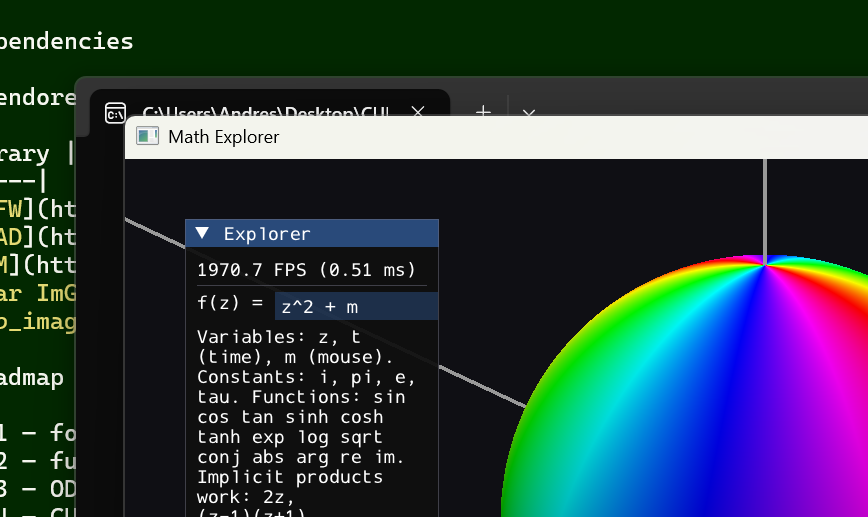

# Mathematics Engine

An engine for exploring mathematics visually,  complex functions on the riemann sphere, ODEs, flows on
manifolds and vector fields next — built on OpenGL, with CUDA interop for GPU compute on
the roadmap. 
Simulations ("sims") are self-contained modules on top of a small engine
library, and can be run all together from an explorer app or as standalone executables.


## Architecture

| Path | What it is |
|---|---|
| `engine/` | Static library: Window, Shader, Camera, Mesh, Shapes, Expression (function parser → CPU eval + GLSL codegen), Sim interface, SimRegistry, App loop, glad + ImGui |
| `sims/<name>/` | One sim per folder: a `Sim` subclass, its own `shaders/`, its own CMakeLists |
| `apps/explorer/` | Multi-sim executable with a runtime sim picker |
| `apps/standalone/` | Generic single-sim `main.cpp`, compiled once per sim |
| `External/` | Vendored dependencies (no installs needed) |
| `obsidian_twin/` | Markdown mirror of the architecture — open it in Obsidian to navigate the design, decision records and roadmap |
| `learnOpenGL/`, `custom/`, `explanations/` | Frozen learning playground the project grew out of |

Sims implement the `engine::Sim` interface (`init` / `update` / `render` / `drawUI`) and
own their GL resources through the engine's RAII wrappers (`Mesh`, `Shader`). The
`engine::Expression` module is sim-agnostic: one parse gives both CPU evaluation
(`std::complex<double>`) and GLSL codegen over caller-defined variables, so future sims
reuse the same typed-function input.

## Build

Requires Visual Studio (MSVC + CMake + Ninja) — the presets read `VSINSTALLDIR`, so from
a plain shell enter a developer environment first (`VsDevCmd.bat -arch=x64`, or use a
Developer PowerShell / the VS IDE).

```powershell
cmake --preset x64-debug
cmake --build out/build/x64-debug
```

Presets: `x64-debug`, `x64-release`, `x86-debug`, `x86-release`.

## Run

```powershell
# all sims, runtime picker
.\out\build\x64-debug\apps\explorer\explorer.exe

# one sim only
.\out\build\x64-debug\sims\riemann_sphere\riemann_sphere_standalone.exe
```

## Dependencies

All vendored under `External/` — nothing to install.

| Library | Purpose |
|---|---|
| [GLFW](https://www.glfw.org/) | Window & input |
| [GLAD](https://glad.dav1d.de/) | OpenGL loader |
| [GLM](https://github.com/g-truc/glm) | Vector/matrix math |
| [Dear ImGui](https://github.com/ocornut/imgui) | UI layer |
| [stb_image](https://github.com/nothings/stb) | Image loading |


## Sims

### riemann_sphere — complex functions on the Riemann sphere



Type any complex function `f(z)` into the UI and see its domain coloring on the Riemann
sphere (hue = argument, brightness = modulus), live:

- Full expression language: `+ - * / ^`, implicit multiplication (`2z`, `(z-1)(z+1)`),
  functions `sin cos tan sinh cosh tanh exp log sqrt conj abs arg re im`, constants
  `i pi e tau`.
- Live variables: `t` (time in seconds) and `m` (mouse as a complex number) — try
  `z^2 + m` or `sin(t)*z^3 - 1`.
- The typed expression is parsed to an AST, compiled to GLSL and hot-swapped into the
  fragment shader in one frame; parse errors show in red while the previous function
  keeps rendering.
- Controls: WASD orbits, Q/E zooms (slows near the surface), Esc quits.


Details, decision records and module notes live in `obsidian_twin/` (best viewed in Obsidian).
