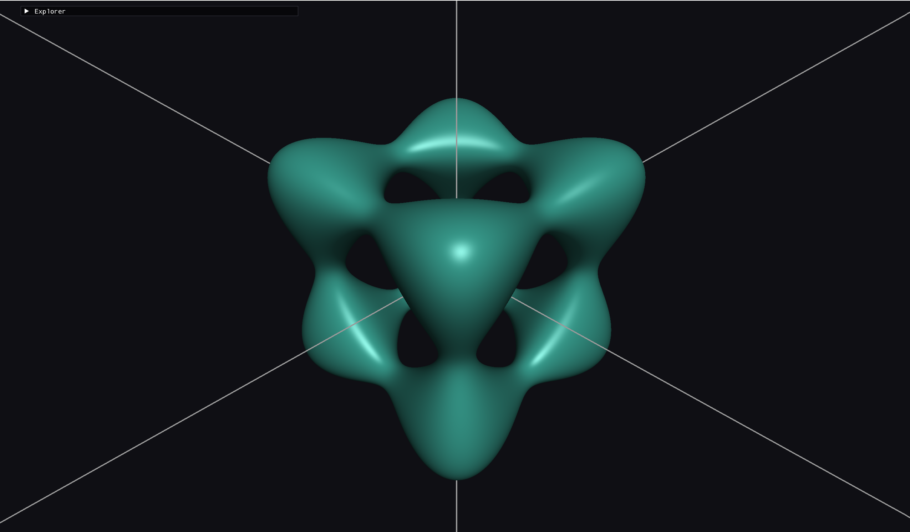
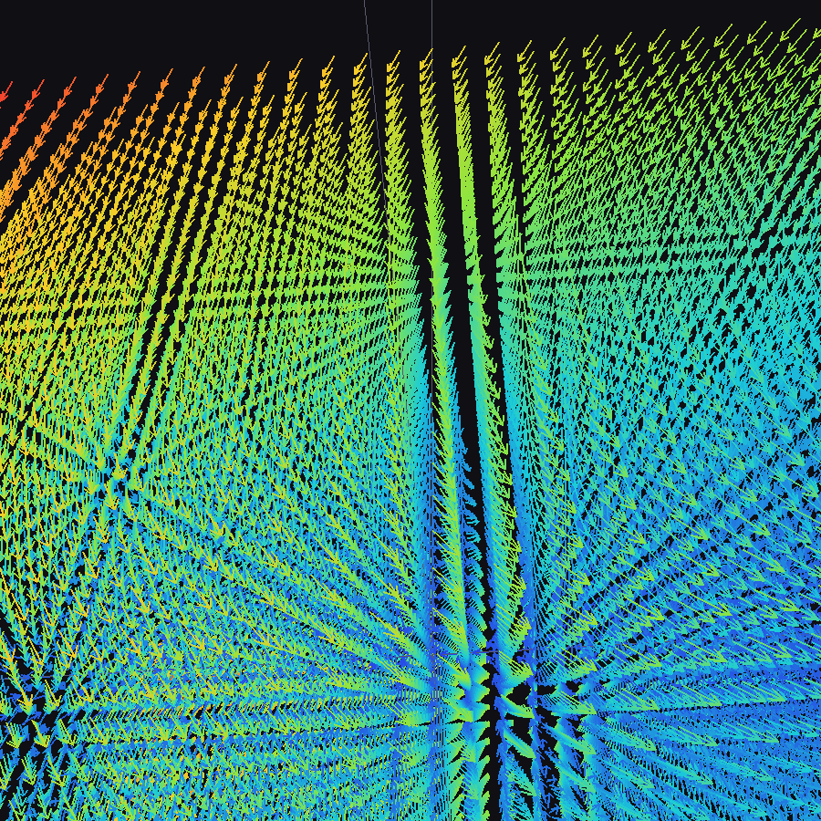
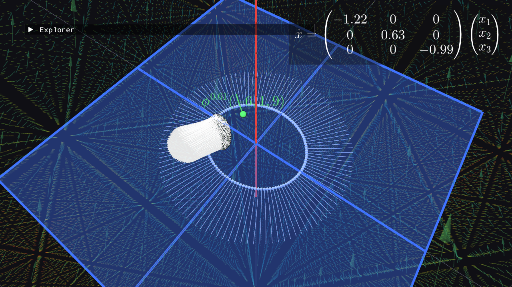
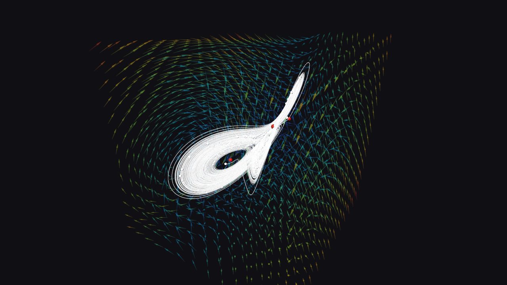
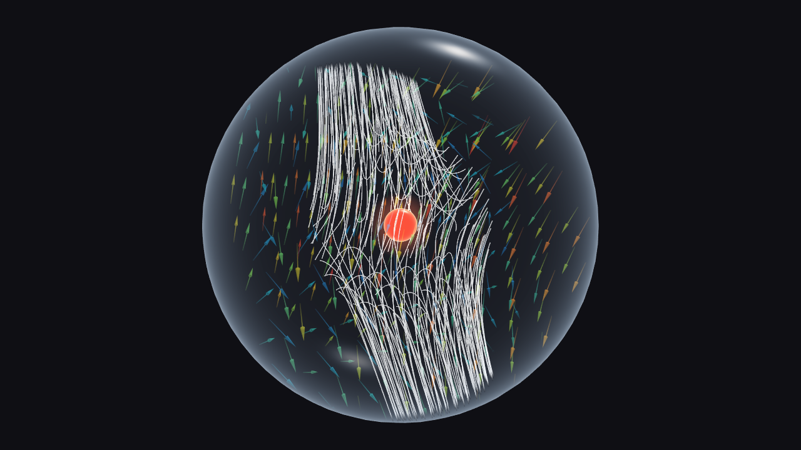
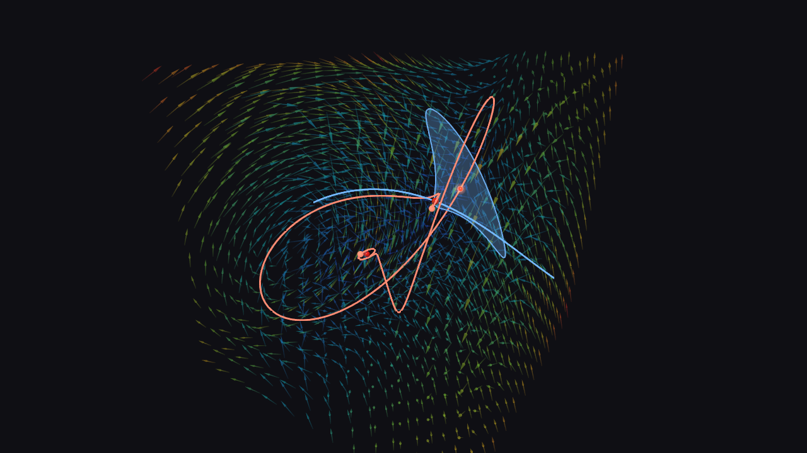
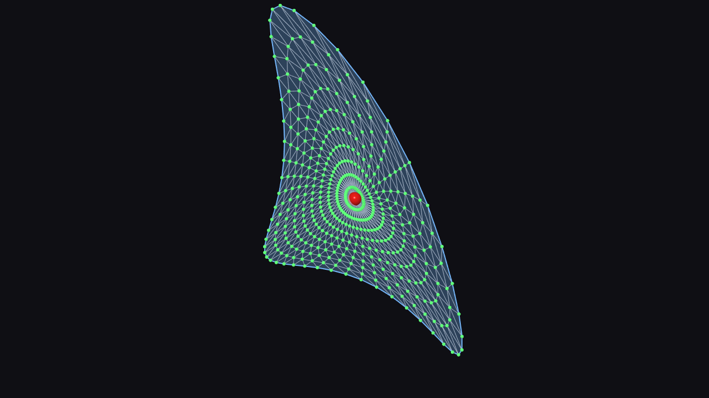

# Mathematics Engine

An engine for exploring mathematics visually — complex functions on the Riemann sphere,
raymarched implicit surfaces `f(x,y,z) = c`, vector fields and their flows, and the
local and global dynamics of the Lorenz system (linearization, Hartman–Grobman,
stable and unstable manifolds) — built on OpenGL, with CUDA interop for GPU compute on
the roadmap.
Simulations ("sims") are self-contained modules on top of a small engine
library, and can be run all together from an explorer app or as standalone executables.


## Architecture

| Path | What it is |
|---|---|
| `engine/` | Static library: Window, Shader, Camera, Mesh, Shapes, Expression (function parser → CPU eval + GLSL codegen), Sim interface, SimRegistry, App loop, glad + ImGui |
| `sims/<name>/` | One sim per folder: a `Sim` subclass, its own `shaders/`, its own CMakeLists |
| `apps/explorer/` | Multi-sim executable; opens on a thumbnail menu of all registered sims |
| `apps/standalone/` | Generic single-sim `main.cpp`, compiled once per sim |
| `External/` | Vendored dependencies (no installs needed) |
| `obsidian_twin/` | Markdown mirror of the architecture — open it in Obsidian to navigate the design, decision records and roadmap |
| `learnOpenGL/`, `custom/`, `explanations/` | Frozen learning playground the project grew out of |

Sims implement the `engine::Sim` interface (`init` / `update` / `render` / `drawUI`) and
own their GL resources through the engine's RAII wrappers (`Mesh`, `Shader`). The
`engine::Expression` module is sim-agnostic: one parse gives both CPU evaluation
(`std::complex<double>`) and GLSL codegen over caller-defined variables, so future sims
reuse the same typed-function input.

## Build

Requires Visual Studio (MSVC + CMake + Ninja) — the presets read `VSINSTALLDIR`, so from
a plain shell enter a developer environment first (`VsDevCmd.bat -arch=x64`, or use a
Developer PowerShell / the VS IDE).

```powershell
cmake --preset x64-debug
cmake --build out/build/x64-debug
```

Presets: `x64-debug`, `x64-release`, `x86-debug`, `x86-release`.

## Run

```powershell
# all sims, thumbnail picker menu
.\out\build\x64-debug\apps\explorer\explorer.exe

# one sim only
.\out\build\x64-debug\sims\riemann_sphere\riemann_sphere_standalone.exe
.\out\build\x64-debug\sims\surface_renderer_ray_marched\surface_renderer_ray_marched_standalone.exe
```

## Dependencies

All vendored under `External/` — nothing to install.

| Library | Purpose |
|---|---|
| [GLFW](https://www.glfw.org/) | Window & input |
| [GLAD](https://glad.dav1d.de/) | OpenGL loader |
| [GLM](https://github.com/g-truc/glm) | Vector/matrix math |
| [Dear ImGui](https://github.com/ocornut/imgui) | UI layer |
| [stb_image](https://github.com/nothings/stb) | Image loading |


## Sims

### riemann_sphere — complex functions on the Riemann sphere


Type any complex function `f(z)` into the UI and see its domain coloring on the Riemann
sphere (hue = argument, brightness = modulus), live:

- Full expression language: `+ - * / ^`, implicit multiplication (`2z`, `(z-1)(z+1)`),
  functions `sin cos tan sinh cosh tanh exp log sqrt conj abs arg re im`, constants
  `i pi e tau`.
- Live variables: `t` (time in seconds) and `m` (mouse as a complex number) — try
  `z^2 + m` or `sin(t)*z^3 - 1`.
- The typed expression is parsed to an AST, compiled to GLSL and hot-swapped into the
  fragment shader in one frame; parse errors show in red while the previous function
  keeps rendering.
- Plane mode toggle: the same function graphed on the flat complex plane instead of the
  sphere — WASD pans, Q/E zooms the domain window (the geometry never moves, only the
  coordinates do).
- Controls: WASD orbits, Q/E zooms (slows near the surface), Esc quits.

### surface_renderer_ray_marched — implicit surfaces `f(x,y,z) = c`



Type a real function of three variables and a level `c`, and see the level set — the
surface `f(x,y,z) = c` carves out of space — raymarched per pixel with no mesh at all:

- Same expression language as the Riemann sphere sim, over `x, y, z` and `t` (time);
  the real part of the value is the field. Try the default tangle cube
  `x^4 + y^4 + z^4 - 5*(x^2 + y^2 + z^2)`, a torus
  `(3-sqrt(x^2+y^2))^2 + z^2 - 1`, or `sin(x)*sin(y)*sin(z)`.
- `c` is a slider (a shader uniform, so no recompile): sweep it and watch the surface
  change topology live at the critical values of `f` — components merging, handles
  forming and splitting.
- Because a typed `f` is not a signed distance field, rays are marched with fixed-step
  sign-change detection plus bisection refinement, not sphere tracing — arbitrary
  equations stay robust.
- Two-sided shading tells the sides apart (teal: `f > c`, amber: `f < c`); a `domain
  radius` control bounds the searched region.
- Method survey (marching cubes, dual contouring, particles, the parametrization
  question) with paper references: `docs/level-set-meshing-proposal.html` — the meshed,
  CUDA-accelerated sibling sim is the planned next step.


### vector_field — any vector field on R² or R³



Type a field `f(v)` and see it as arrow glyphs colored by magnitude, with
`v̇ = f(v)` typeset from exactly what you typed:

- Drop a ball (a disk in R²) of initial conditions and watch it deform under the flow,
  or click to drop single trajectories, each labelled `φᵗ(x₀)`.
- Presets: the classic phase portraits in R² (saddle, center, spiral sink, van der Pol,
  damped pendulum, a time-dependent field) and the strange attractors in R³ (Lorenz,
  Rössler, Thomas).
- Arrow keys set the flow's speed and direction, Space pauses; the camera can follow
  the newest trajectory.

### diagonal_linear — a diagonal linear system in R³



`v̇ = diag(λ₁, λ₂, λ₃) v` with its stable (blue) and unstable (red) eigenspaces drawn in.
Balls of initial conditions show what the flow does to volumes: they stretch along
`Eᵘ`, collapse onto it as the `Eˢ` components decay, and their volume scales by
`e^{(λ₁+λ₂+λ₃)t}`.

### lorenz_flow — the global Lorenz flow



The Lorenz system with live `σ, ρ, β`: arrow field, balls and single trajectories, and
its equilibria `O`, `C₊`, `C₋` as red beads. Hovering a bead shows its linearization
(eigenvalues, type); clicking flies the camera onto it and hands off seamlessly to
`lorenz_equilibrium`.

### lorenz_equilibrium — Hartman–Grobman at one equilibrium



The flow near one equilibrium `v*`, inside a glass ball `V` with everything clipped to
it — where Hartman–Grobman says the flow looks like its linearization:

- Stage A: `Eˢ`, `Eᵘ` through `v*`, and the field `f` against `A(v − v*)`.
- Stage B: the linear flow keeps `Eˢ` flat, the true flow doesn't — only the curved
  stable manifold `Wˢ = v* + Kₛ(θ)` (parametrization method) is invariant.
- Stage C: the conjugacy itself — a linear ball `U` next to its image `V`, paired orbits,
  and a check of how large the ball may be.
- Backspace flies back out to `lorenz_flow`.

### lorenz_manifold_growth — growing stable and unstable manifolds



The global Lorenz flow again, but hovering a bead opens a small popup to grow its
manifolds:

- **Grow `W_loc`** grows the local stable or unstable manifold out of `v*` — the Taylor
  patch of the parametrization method, drawn out to the radius where it is still
  accurate (both sides of one equilibrium share it).
- **Grow `W`** carries a one-dimensional manifold on globally: the two ends of the local
  curve flow on, forward on `Wᵘ` (`W^u(O)` winds onto the attractor) and backward on
  `Wˢ` (slowed and frozen far out, since the backward Lorenz flow blows up).
  `watch` rides a branch with the camera, with pause / extend.
- Two-dimensional manifolds need geodesic level sets: their **Learn geodesic level
  sets** button zooms onto the patch and switches to the sim below.

### learn_geodesic_level_sets — geodesic level sets, step by step



A walkthrough of growing a two-dimensional manifold (`Wˢ(O)` by default) with geodesic
level sets, built one visual step at a time:

- The local manifold alone, with its triangle mesh (`M`); the edge's points kept between
  `minSpread` and `maxSpread` apart.
- Pick an edge point `r`: the view stands upright on it and shows its neighbours `r±`
  and the half-plane `F_r` through `r`, perpendicular to the edge.
- A green ball slides along the edge: double-click (or `V`, or shoot a whole row from
  `r` to the ball) to launch slow particles in the manifold's direction of time
  (backward on `Wˢ`); where one crosses `F_r` it stops at a golden `b_r(τ)` labelled with
  its distance to `r`. `B` launches the whole edge at once — the ring tears apart,
  which is why the surface isn't grown by just flowing its edge.
- **Solve geodesic BVP** finds, by continuation along the edge, the point whose orbit
  meets `F_r` at exactly `Δᵢ` from `r` and marks it `r_new`; solved neighbours form
  the next band of triangles, all at the smallest `Δᵢ` reached.

Details, decision records and module notes live in `obsidian_twin/` (best viewed in Obsidian).
